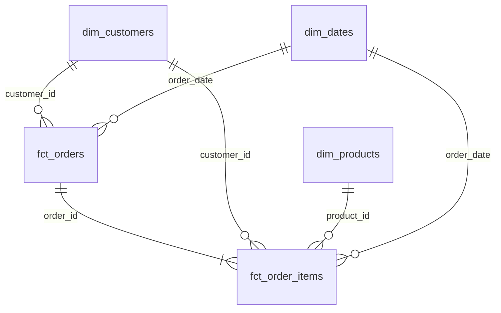
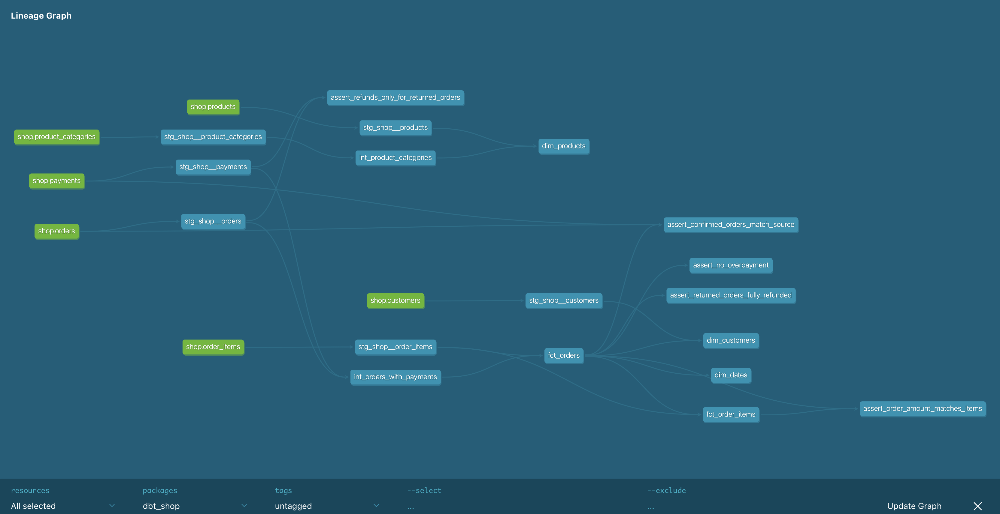

# store_hse

## Модель данных

Сырые данные интернет-магазина загружаются в Greenplum, базу `dwh`, схему `raw`. dbt преобразует их в слоях `analytics_staging`, `analytics_intermediate` и `analytics_marts`.

| Витрина | Одна строка | Пример бизнес-вопроса |
| --- | --- | --- |
| `fct_orders` | Один заказ | Как меняется выручка по месяцам? |
| `fct_order_items` | Один товар в заказе | Какие товары приносят выручку? |
| `dim_customers` | Один клиент, включая клиентов без покупок | Какая доля клиентов из каждого канала стала покупателями? |
| `dim_products` | Один товар | Какова выручка по категориям и брендам? |
| `dim_dates` | Один календарный день | Как меняются продажи по дням недели? |

### Хранение в Greenplum

| Витрина | Хранение | Почему |
| --- | --- | --- |
| `fct_orders` | `DISTRIBUTED BY (order_id)` | Заказы распределяются по номеру заказа. Это ключ соединения с позициями и платежами. |
| `fct_order_items` | `DISTRIBUTED BY (order_id)`, колоночное | Совпадающий ключ позволяет соединять позиции с заказами по `order_id`. Отчёты часто читают отдельные колонки факта. |
| `dim_customers` | `DISTRIBUTED REPLICATED` | Небольшой справочник из 40 клиентов доступен на каждом сегменте. |
| `dim_products` | `DISTRIBUTED REPLICATED` | Небольшой справочник из 13 товаров доступен на каждом сегменте. |
| `dim_dates` | `DISTRIBUTED REPLICATED` | Небольшой календарь из 133 дней доступен на каждом сегменте. |

Сырые `raw.order_items` и `raw.payments` распределены по `order_id`. Для фактов выбран тот же ключ: при соединении факта позиций с фактом заказов строки одного заказа оказываются на одном сегменте. Если распределить эти факты по разным ключам, Greenplum придётся пересылать строки между сегментами.

Календарь `dim_dates` строится с помощью `dbt_utils.date_spine`. Пакет указан в `packages.yml` и устанавливается командой `dbt deps`.

Тест `assert_no_overpayment` выдаёт предупреждение для заказа 113: сумма заказа 200, успешные списания 400 (два раза по 200). Исходные данные оставлены без изменения.

### Граф зависимостей

